<div align="center">


# Workspace

**A complete Notion-style workspace (pages, databases and teamwork) that lives on your
computer, syncs through your own server, and speaks Notion's API. Everything in Notion's core,
without the AI.**

[](https://github.com/Ariehant/Workspace/actions/workflows/ci.yml)


[Features](#features) · [Screenshots](#screenshots) · [Install](#install) ·
[Use it](#use-it) · [Self-host](docs/self-hosting.md) · [API](docs/api.md) ·
[Docs](docs/README.md) · [Roadmap](#roadmap)

<br>

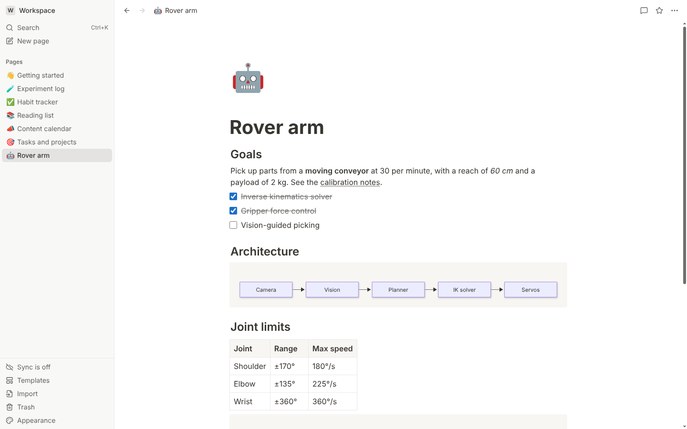

</div>

## Why Workspace

- **Offline first.** The desktop app is complete on its own. Everything is saved locally as you
  type, in one SQLite file, and nothing needs an account.
- **Your server, when you want one.** Add the self-hosted server (Docker Compose behind Caddy) to
  sync devices, work with others in real time, publish pages and use the web app. Edits made
  offline merge cleanly when you reconnect, because every page is a CRDT (Yjs).
- **Notion-compatible.** Import a Notion export, and point existing Notion integrations at your
  server: the official `@notionhq/client` SDK works against it unchanged.
- **Bring everything in.** Word and Google Docs files, Evernote, Trello, Asana, Jira,
  monday.com and Confluence exports, Markdown, HTML and CSV come in with their structure.
- **No AI, no lock-in.** Export everything as Markdown, CSV, HTML or PDF, or back up the whole
  workspace to a `.zip`.

## Features

<table>
<tr>
<td width="50%" valign="top">

**Editor**

- Slash menu, Markdown shortcuts, drag handles and columns
- Headings, lists, to-dos, toggles, callouts, quotes, tables with coloured rows and columns
- Code with highlighting for ~190 languages, Mermaid diagrams, KaTeX equations
- Images, video, audio, PDFs, files, bookmarks and embeds
- @-mentions of pages, people and dates, reminders, emoji; link mentions with the site's title
- Tabs, synced blocks, buttons, table of contents, find and replace
- Embed any website; YouTube, Figma, Google Docs, Miro, GitHub Gists and more
- `/` commands for everything, and Notion's keyboard shortcuts (`Ctrl+?` lists them)
- Present a page as slides, full screen
- Verified pages: who checked a page, and until when

</td>
<td width="50%" valign="top">

**Databases**

- Table, board, list, gallery, feed, calendar, timeline, chart and form views
- 20+ property types, with Notion's Formula 2.0 language
- Relations, rollups, sub-items and dependencies
- Filters (nested AND/OR), sorts, groups, calculations per view
- Numbers as bars or rings, frozen columns, load limits, wrapped or compact rows
- Bulk edit: pick rows and set a property, duplicate or delete them at once
- Templates (and templates that repeat daily, weekly or monthly), linked and locked views
- Row pages as peeks, with a layout: pinned properties, related pages as sections
- Forms with conditional questions and file uploads, shareable by link
- Automations: on a new page, a changed property or a schedule

</td>
</tr>
<tr>
<td valign="top">

**Workspace**

- Home: recent pages, upcoming reminders, recent edits
- People: everyone in the workspace, and the pages each one made
- Page tree with drag and drop, favorites, trash
- Quick find (`Ctrl+K`) with filters: titles only, section, last edited, created by
- Tabs, several windows, back and forward, `workspace://` links
- Backlinks, page history with restore, a templates gallery
- Import from Notion, Word, Google Docs, Evernote, Trello, Asana, Jira, monday.com and
  Confluence, and Markdown, HTML and CSV
- One Settings window (`Ctrl+,`); custom emoji for the whole workspace
- Export Markdown & CSV, HTML, PDF (a page, or the whole workspace with contents); full backups
- Light, dark and system themes

</td>
<td valign="top">

**Together, on your server**

- Accounts with passwords or single sign-on (OpenID Connect)
- Members, guests, groups, teamspaces and per-page sharing, with requests for access
- Share links for people outside the workspace, and "can create pages" for request trackers
- Live cursors and presence, comments (shown, minimized or hidden per page), suggested edits
- An inbox for mentions, comments and reminders, with email digests
- Publish pages to the web, and a web app with the same UI
- A Notion-compatible REST API with integration tokens and webhooks

</td>
</tr>
</table>

The full inventory, block by block, is in [docs/features.md](docs/features.md).

## Screenshots

|                                                                                                                                                                                                  |                                                                                                                                                                                |
| :----------------------------------------------------------------------------------------------------------------------------------------------------------------------------------------------: | :----------------------------------------------------------------------------------------------------------------------------------------------------------------------------: |
|                                     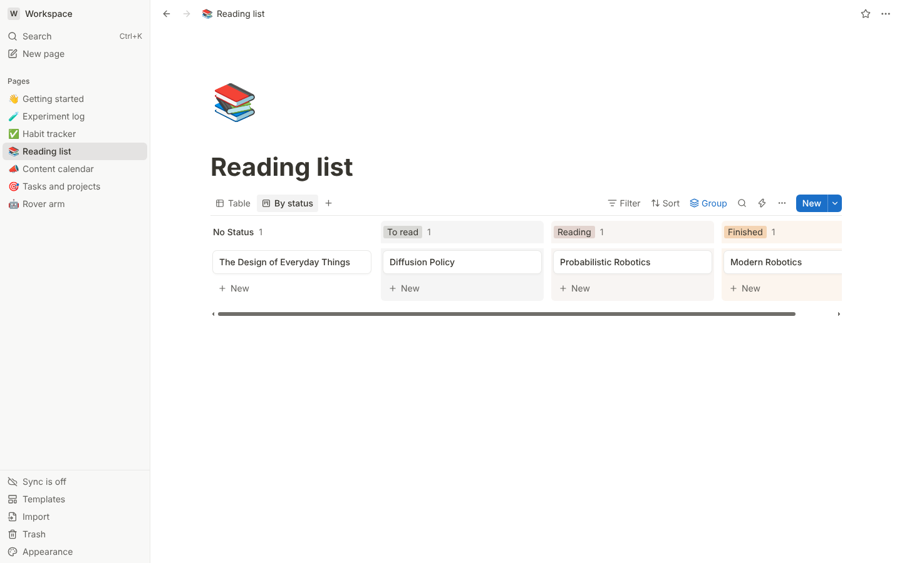<br>**Board view**, grouped by status                                      |                    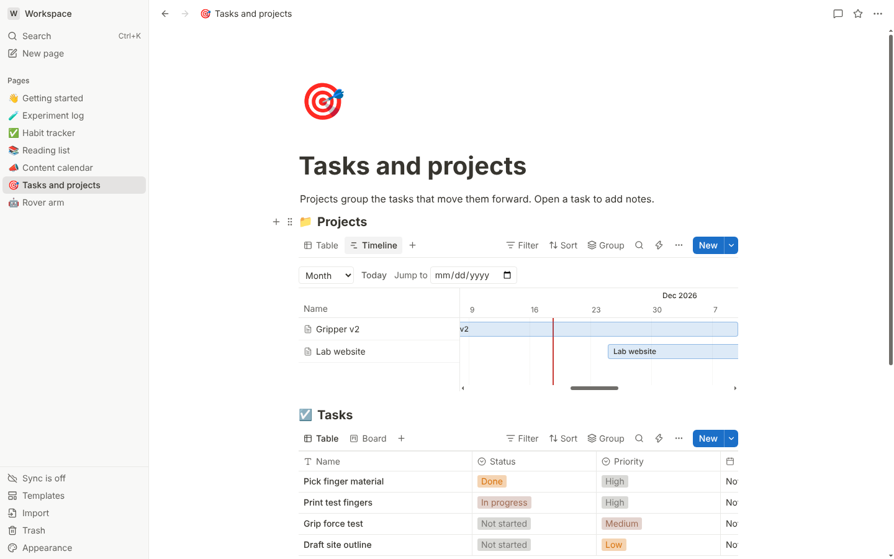<br>**Timeline** and a related table                    |
|                                   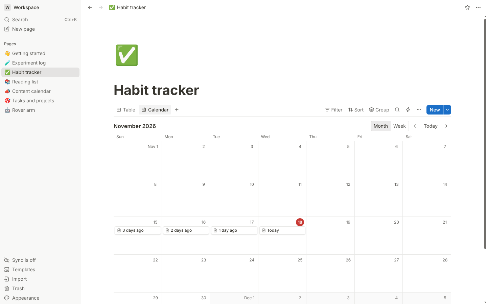<br>**Calendar** of database pages                                    |                     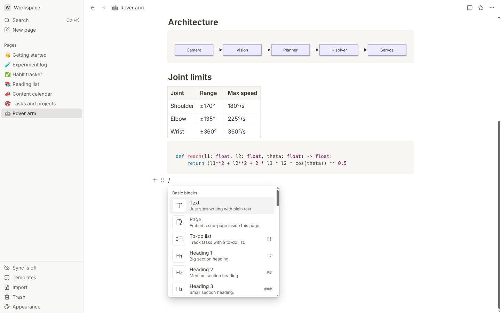<br>**Slash menu** for every block type                     |
|                                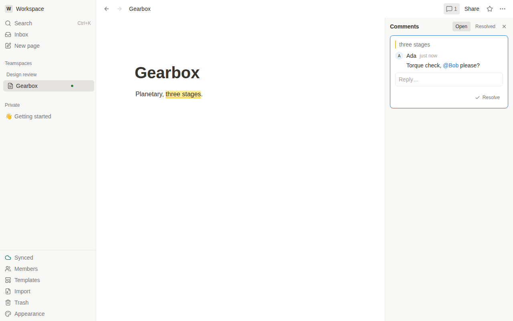<br>**Comments** on text, with mentions                                |            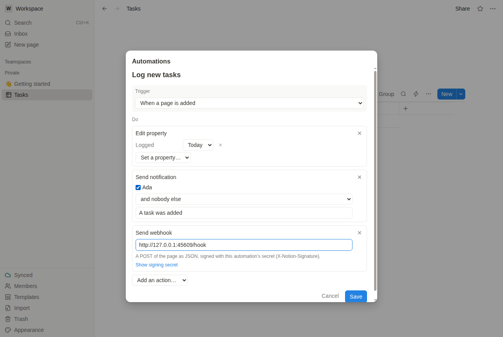<br>**Automations** with webhooks             |
|              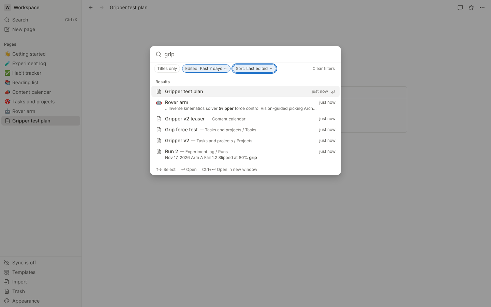<br>**Quick find** with filters               |           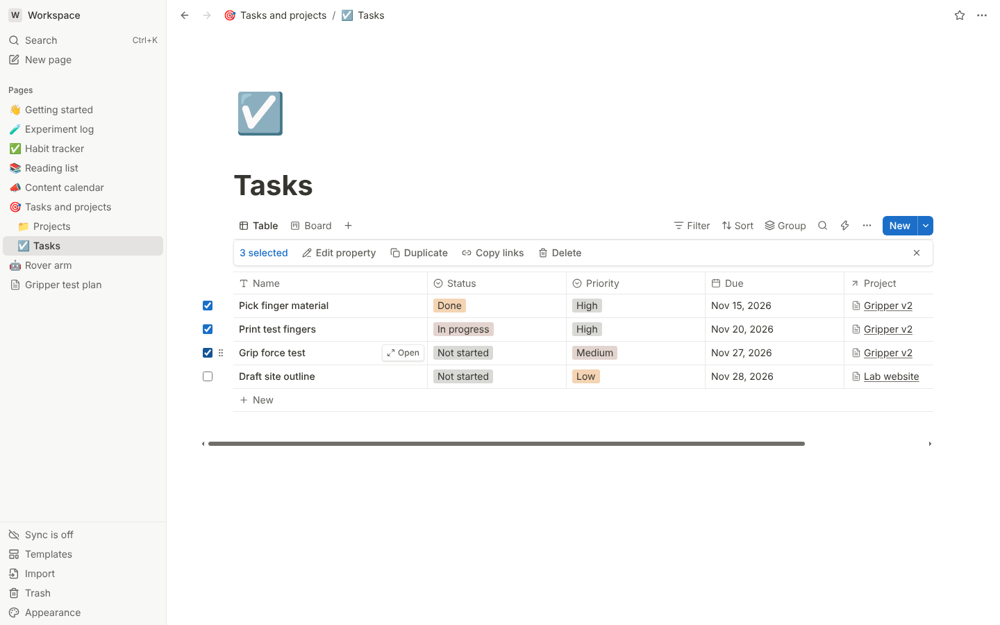<br>**Bulk edit** selected rows           |
| 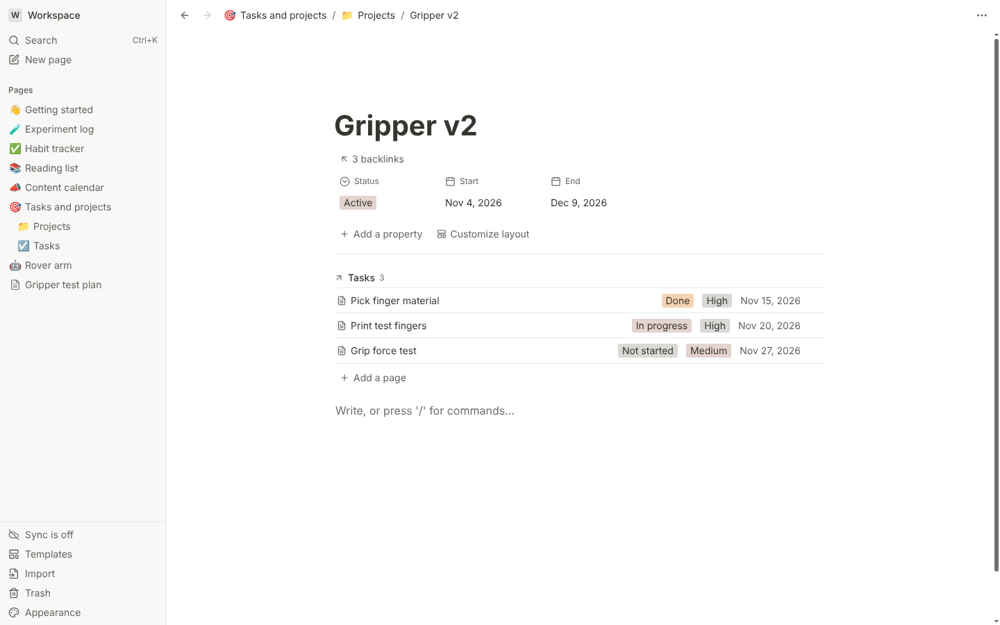<br>**Row page layouts**, with related pages | 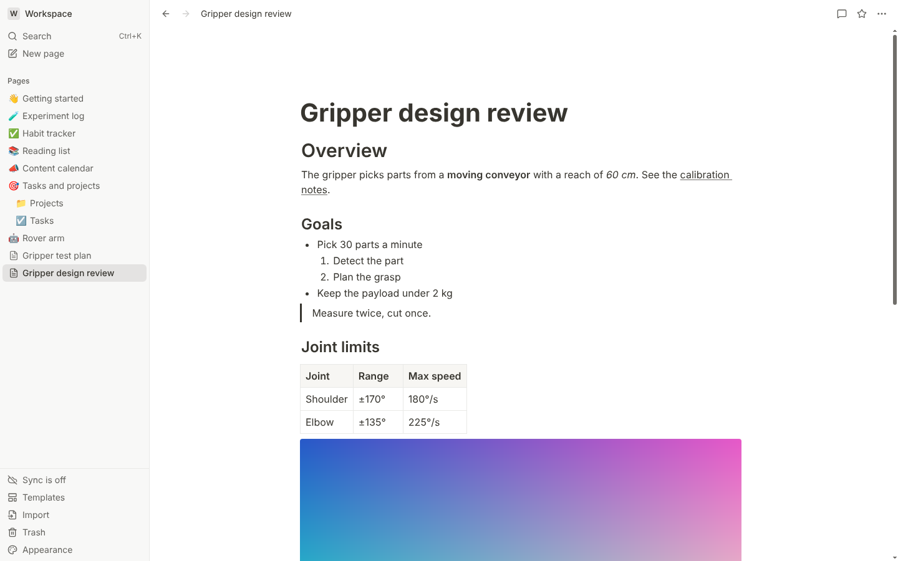<br>**Word and Google Docs** imported |
|                  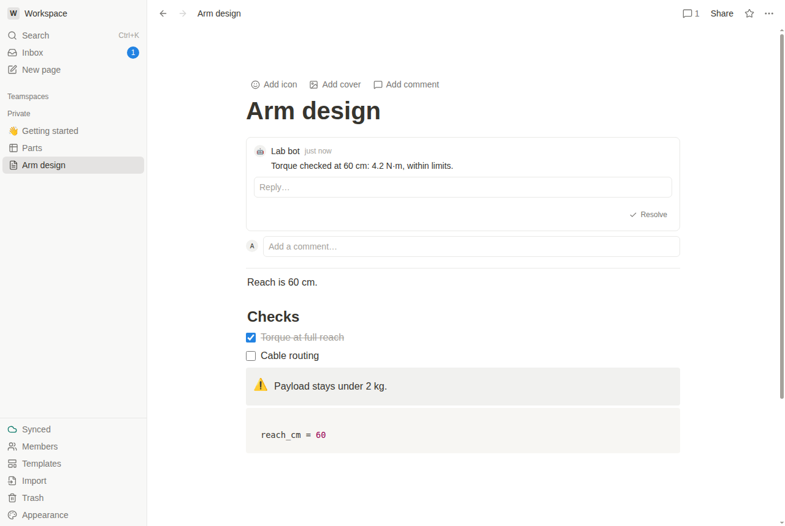<br>Content and comments **from the API**, live                   |                                      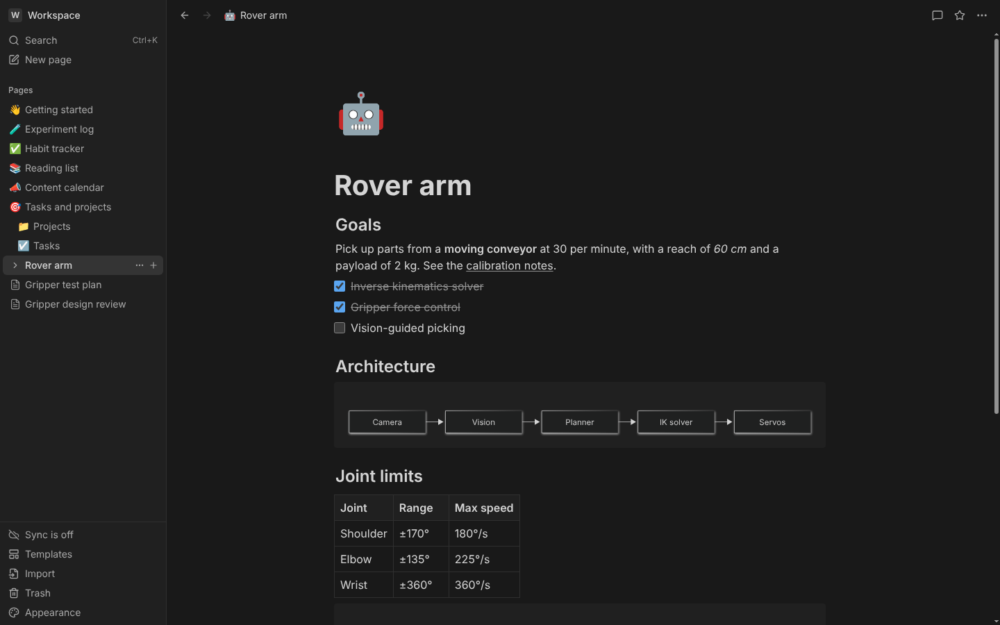<br>**Dark theme**                                      |

## Install

### The desktop app

Workspace runs on **Windows 10 and 11** and on **Ubuntu 24.04 and later** (x86-64).

#### Windows

1. Open the newest [release](https://github.com/Ariehant/Workspace/releases) (or the
   [latest build](https://github.com/Ariehant/Workspace/releases/tag/latest-build) of `main`) and,
   under **Assets**, download `Workspace-Setup-<version>.exe`.
2. Run it. It installs for your user (no administrator rights needed) and adds **Workspace** to
   the Start menu.
3. The installer isn't signed yet, so SmartScreen may say "Windows protected your PC": choose
   **More info**, then **Run anyway**.

Your workspace is kept in `%APPDATA%\workspace-app`. The app updates itself: a new version
downloads in the background, and **Restart to update** installs it; your data stays. [Workspace Calendar](docs/calendar-app/README.md) has its own installer
in the same place, `Workspace-Calendar-Setup-<version>.exe`.

#### Ubuntu

Download it from the repository's
[Releases](https://github.com/Ariehant/Workspace/releases) page: each release has a `.deb`, an
AppImage, a Snap and a Flatpak, with `SHA256SUMS`. The first one will be a release candidate,
`v1.0.0-rc.1`.

**Until the first release is out,** download the
[latest build](https://github.com/Ariehant/Workspace/releases/tag/latest-build) from the same
page: a pre-release of `main` that CI publishes after its tests pass and replaces with every
change (unsigned, and it doesn't update itself).

```sh
# The .deb from the release's Assets (here, into ~/Downloads), then:
sudo apt install ~/Downloads/workspace-app_*_amd64.deb
```

Prefer the `.deb`: it installs an AppArmor profile so Chromium's sandbox works under Ubuntu
24.04's restrictions. The AppImage, the apt repository (from v1.0.0), where your data lives and
backups are covered in the [desktop guide](docs/desktop.md).

**From source** instead (Node.js 22.13 or later): clone the repository and build the packages.

```sh
git clone https://github.com/Ariehant/Workspace.git
cd Workspace
corepack enable        # pnpm, at the version the repo pins
pnpm install
pnpm package           # .deb and AppImage in apps/desktop/dist/
sudo apt install ./apps/desktop/dist/workspace-app_*_amd64.deb
```

### The sync server

```sh
cd infra
cp .env.example .env   # set DOMAIN and POSTGRES_PASSWORD
docker compose up -d
```

Caddy gets a certificate for your domain, and `https://<DOMAIN>` serves the web app. On a
desktop, open **Sync** in the sidebar and enter the same address. The first account becomes the
server admin. Single sign-on, email, S3 storage, backups and the admin CLI are in the
[self-hosting guide](docs/self-hosting.md).

## Use it

New to Workspace? The [getting started guide](docs/getting-started.md) is a short tour. In
brief:

1. **Write.** **New page** (`Ctrl+N`), then type. `/` opens the menu of every block and
   command; Markdown shortcuts work as you type (`#`, `-`, `[]`, `>`).
2. **Organise.** Nest pages in the sidebar, star favorites, and start a database from an empty
   page (**Get started with → Database**) or with `/database`. Add views: board, calendar,
   timeline and more.
3. **Bring your documents.** **Import** in the sidebar takes a Notion export, Word and Google
   Docs files, and more. Nothing is lost silently: a report lists anything that didn't come
   across.
4. **Find anything.** `Ctrl+K` searches every title and paragraph, with filters.
5. **Work together.** Connect to your server (the sync line in the sidebar), invite people from
   **Members…**, and share pages. Comments, mentions and the inbox keep everyone up to date; the
   same workspace opens in a browser.
6. **Keep it yours.** Export to Markdown, HTML or PDF any time, and back up the whole workspace
   to one `.zip`.

### Use the API

Make an integration in **Members → Integrations**, connect pages to it (**Share → Connections**),
and use Notion's SDK with your server as the base URL:

```js
import { Client } from '@notionhq/client';

const notion = new Client({
  auth: process.env.WORKSPACE_TOKEN,
  baseUrl: 'https://notes.example.com',
});
const { results } = await notion.search({ query: 'Roadmap' });
```

Endpoints, versions, webhooks and the differences from Notion are in the [API guide](docs/api.md).

## Development

You need Node.js 22.13 or later (24 LTS recommended) and pnpm 10 (`corepack enable`).

```sh
pnpm install
pnpm dev               # the desktop app with hot reload
```

| Command             | What it does                                                                   |
| ------------------- | ------------------------------------------------------------------------------ |
| `pnpm dev`          | Run the desktop app in development mode                                        |
| `pnpm dev:web`      | The web app with hot reload (`VITE_SERVER=<server url>`)                       |
| `pnpm build`        | Build every package                                                            |
| `pnpm lint`         | ESLint, and a check of every link in the Markdown docs                         |
| `pnpm typecheck`    | Type-check every package                                                       |
| `pnpm test`         | Unit and integration tests (Vitest, with a throwaway Postgres)                 |
| `pnpm test:e2e`     | End-to-end tests driving the real Electron app (Playwright)                    |
| `pnpm test:e2e:web` | The web app's end-to-end tests (Chromium, real server)                         |
| `pnpm format`       | Prettier                                                                       |
| `pnpm package`      | Build the `.deb` and AppImage into `apps/desktop/dist/`                        |
| `pnpm bench`        | The performance budgets' pure-code suite ([more](CONTRIBUTING.md#performance)) |

The Windows installer is built on Windows: `pnpm --filter @workspace/desktop package:win` (into
`apps/desktop/dist/`). End-to-end tests need a display: on a headless machine, run
`pnpm --filter @workspace/desktop build`, then `xvfb-run -a pnpm test:e2e`. See [CONTRIBUTING.md](CONTRIBUTING.md) for how the
repo is organised and what a change needs before it's merged.

## Architecture

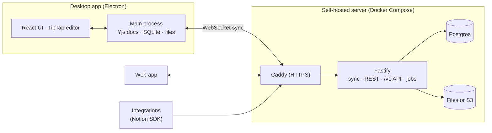

- **Every page and database is a Yjs document.** Concurrent and offline edits always merge, so
  sync and real-time collaboration are additions, not rewrites.
- **The desktop's main process owns the data.** It keeps live documents, appends each update to
  SQLite (`node:sqlite`, with FTS5 search) and relays it to windows, which are sandboxed and use
  a typed preload API.
- **The server checks every write.** Sync messages are authorized per document and per role, and
  the API, forms and automations edit documents through the same checks.
- **One UI, two hosts.** `packages/app` reaches its host only through a `Platform` interface, so
  the desktop and the web app share every screen.

| Path                      | What's there                                                        |
| ------------------------- | ------------------------------------------------------------------- |
| `apps/desktop`            | Electron main process, preload bridge, packaging, E2E tests         |
| `apps/server`             | The server: auth, sync, search, files, the `/v1` API, jobs          |
| `apps/web`                | The web app: the shared UI served by the server                     |
| `packages/core`           | The data model on Yjs: pages, the page tree, blocks, comments       |
| `packages/editor`         | TipTap extensions for every block type                              |
| `packages/database`       | Properties, formulas, filters, sorts, views, automations            |
| `packages/app`            | Shared React screens: sidebar, pages, databases, settings           |
| `packages/ui`             | Design tokens, themes and components                                |
| `packages/storage-local`  | SQLite persistence and search for the desktop                       |
| `packages/storage-remote` | Postgres store for the server: migrations, the update log, accounts |
| `packages/sync`           | The sync protocol: messages, the server hub and clients             |
| `packages/api-model`      | Notion's API objects, both ways                                     |
| `packages/importers`      | Notion, Word, Evernote, Trello, Asana, Jira, Confluence, Markdown   |
| `packages/exporters`      | Markdown, CSV, HTML, PDF and backups                                |
| `infra`                   | Docker Compose stack, Caddyfile, systemd unit, backup script        |

The design decisions and their reasons are in [docs/PLAN.md](docs/PLAN.md#1-architecture).

## Roadmap

| Phase                        | Status           | Plan and notes                            |
| ---------------------------- | ---------------- | ----------------------------------------- |
| 0. Foundation                | ✅ Done          | [PLAN.md](docs/PLAN.md#8-phase-0-outcome) |
| 1. Editor and navigation     | ✅ Done          | [PHASE1.md](docs/PHASE1.md)               |
| 2. Databases                 | ✅ Done          | [PHASE2.md](docs/PHASE2.md)               |
| 3. Power features            | ✅ Done          | [PHASE3.md](docs/PHASE3.md)               |
| 4. Sync server               | ✅ Done          | [PHASE4.md](docs/PHASE4.md)               |
| 5. Collaboration             | ✅ Done          | [PHASE5.md](docs/PHASE5.md)               |
| 6. Automations and API       | ✅ Done          | [PHASE6.md](docs/PHASE6.md)               |
| 7. Polish and release (v1.0) | 🚧 Release check | [PHASE7.md](docs/PHASE7.md)               |
| 8. Notion's newer features   | ✅ Done          | [PHASE8.md](docs/PHASE8.md)               |

Out of scope: Notion AI, Notion Mail, Notion Calendar as a separate app, and the marketplace.

## License

Workspace is free software under the [GNU Affero General Public License 3.0](LICENSE) or later:
free to use, change and self-host. If you change it and run it for others (a server people use
over the network), offer them your changed source: set `SOURCE_URL` on the server to where it
is, and the apps' **About** links there.
